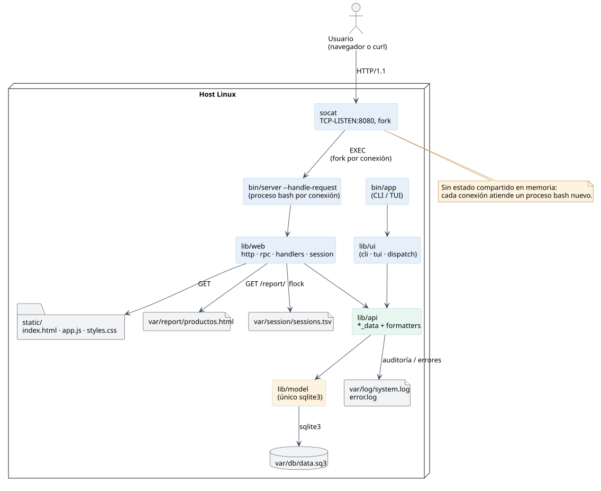
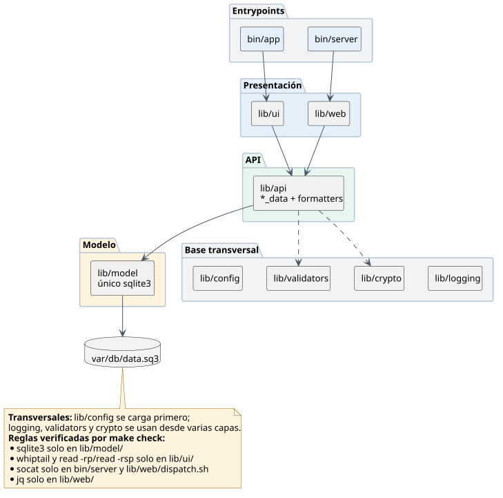

# 01 — Arquitectura

## Objetivo

La app resuelve un ABM de inventario con usuarios y reporte HTML. La misma API
se consume desde tres clients de presentación:

- **CLI** (`./ejercicio-5.sh --cli`): menús por `stdin`/`stdout`.
- **TUI** (`./ejercicio-5.sh`): pantallas con `whiptail`.
- **Web** (`./server.sh`): navegador sobre HTTP + JSON-RPC 2.0.

El objetivo del Lab 07 es agregar el tercer client **sin duplicar reglas** ni
romper los dos existentes.

## Restricciones de diseño

1. **Transparencia funcional**: mismos datos, validaciones, logs y reporte que
   el Lab 06. Los mensajes visibles de CLI/TUI no cambian.
2. **Capas**: `presentación → api → model → config`; `logging` es transversal
   y `validators`/`crypto` son puros. Solo `lib/model/` invoca `sqlite3`.
3. **Sin estado compartido en la web**: `socat` hace `fork` por conexión, así
   que la sesión vive en archivo y los datos en SQLite.
4. **Una sola fuente de verdad por dato**: schema en `sql/schema.sql`, DB creada
   solo por `scripts/deploy.sh`, contrato RPC documentado una vez.
5. **Reglas ejecutables**: `make check` verifica sintaxis y fronteras de capas.

## Topología de ejecución



Un request web sigue este recorrido:

```text
navegador/curl → socat (TCP-LISTEN, fork) → bin/server --handle-request
              → lib/web → lib/api → lib/model → sqlite3 (var/db/data.sq3)
```

`bin/server` sin argumentos hace `exec socat ... EXEC:"bin/server
--handle-request"`. Cada conexión es un proceso bash nuevo; no hay arrays ni
caches compartidos entre requests. Por eso el token se valida contra
`var/session/sessions.tsv` con `flock`.

## Capas y dependencias



| Capa | Módulos | Puede depender de | No puede |
|---|---|---|---|
| Entrypoints | `bin/app`, `bin/server` | presentación, api, model, base | lógica de negocio propia |
| Presentación | `lib/ui/`, `lib/web/` | api, base | `sqlite3`, `whiptail` cruzado |
| API | `lib/api/` | model, validators, crypto, logging, config | `sqlite3`, `jq`, UI |
| Modelo | `lib/model/` | config, logging | api, UI, web |
| Base | `config`, `validators`, `crypto`, `logging` | — | capas superiores |

Reglas que `make check` hace cumplir:

- `sqlite3` solo en `lib/model/`.
- `whiptail` y `read -rp`/`read -rsp` solo en `lib/ui/`.
- `socat` solo en `bin/server` y `lib/web/dispatch.sh`.
- `jq` solo en `lib/web/`.

## Inventario de módulos

| Módulo | Responsabilidad | Comandos externos |
|---|---|---|
| `lib/config.sh` | rutas, env vars, regex y constantes del menú | ninguno (`declare`) |
| `lib/validators.sh` | booleanos puros de username, id y producto | bash |
| `lib/crypto.sh` | hash SHA-256 de contraseñas | `sha256sum` |
| `lib/logging.sh` | auditoría en `system.log` y errores en `error.log` | `date`, `printf` |
| `lib/model/db.sh` | `require_db`, `sql_escape`, apertura de SQLite | `sqlite3` |
| `lib/model/products_store.sh` | CRUD de productos | `sqlite3` |
| `lib/model/users_store.sh` | alta/búsqueda de usuarios y hashes | `sqlite3` |
| `lib/api/products_api.sh` | reglas de productos, auditoría, formatters y `*_data` | — |
| `lib/api/auth_api.sh` | registro/login, hash, auditoría y `*_data` | — |
| `lib/api/report_api.sh` | genera `productos.html` desde el modelo | `mkdir` |
| `lib/ui/cli.sh` | menús y mensajes CLI | `read`, `printf` |
| `lib/ui/tui.sh` | pantallas TUI | `whiptail` |
| `lib/ui/dispatch.sh` | selección CLI/TUI | — |
| `lib/web/http.sh` | parseo HTTP, estáticos, MIME, longitud y respuesta | `realpath`, `stat`, `wc`, `head` |
| `lib/web/rpc.sh` | envelope 2.0, registry, validación de token | `jq` |
| `lib/web/handlers.sh` | un handler por método RPC | `jq` |
| `lib/web/session.sh` | creación, validación, revocación y limpieza de sesiones | `flock`, `awk`, `mktemp`, `sha256sum`, `date` |
| `lib/web/dispatch.sh` | entrypoint web, `--check`, `socat` | `socat` |

## Entrypoints y orden de carga

Cada entrypoint tiene **una única lista de `source`**; los módulos tienen guarda
(`_X_LOADED`) y re-sourcear es no-op.

```text
bin/app:
  config → validators → crypto → logging
  → model/db → model/products_store → model/users_store
  → api/products_api → api/auth_api → api/report_api
  → ui/cli → ui/tui → ui/dispatch
  → main "$@"

bin/server:
  config → validators → crypto → logging
  → model/* → api/*
  → web/session → web/http → web/rpc → web/handlers → web/dispatch
  → main "$@"
```

`./ejercicio-5.sh` y `./server.sh` son stubs delgados de entrega: solo delegan
en `bin/app` y `bin/server` respectivamente.

## Datos y archivos

| Path | Dueño | Contenido |
|---|---|---|
| `var/db/data.sq3` | `scripts/deploy.sh` (creación) / `lib/model` (runtime) | usuarios y productos |
| `var/log/system.log` | `lib/logging` | auditoría TSV de éxitos |
| `var/log/error.log` | `lib/logging` | errores de ejecución |
| `var/report/productos.html` | `lib/api/report_api` | reporte derivado y regenerable |
| `var/session/sessions.tsv` | `lib/web/session` | token, uid, username y vencimiento |
| `static/` | repo | UI web (HTML, JS, CSS, favicon) |

`var/session/` está en `.gitignore`; la DB, los logs y el reporte se versionan
como evidencia del lab.

## Por qué esta forma

- **Un solo camino de datos**: CLI/TUI y web llaman a la misma API, así que las
  validaciones, el hash, la auditoría y el reporte son idénticos por
  construcción.
- **Fork-safe**: no hay memoria compartida que se pueda corromper entre
  conexiones; el único estado mutable compartido son archivos protegidos por
  `flock`.
- **Datos estructurados**: las variantes `*_data` devuelven TSV/valores; los
  handlers web serializan con `jq` y los formatters de CLI/TUI conservan sus
  mensajes.
- **Fronteras verificables**: las reglas de capas no son una convención oral;
  `make check` falla si alguien las cruza.

## Lectura siguiente

- [02 — Flujos](02-flujos.md): qué pasa en cada request.
- [03 — Referencia](03-referencia.md): contrato exacto.
- [05 — Decisiones](05-decisiones.md): por qué se eligió cada pieza.
