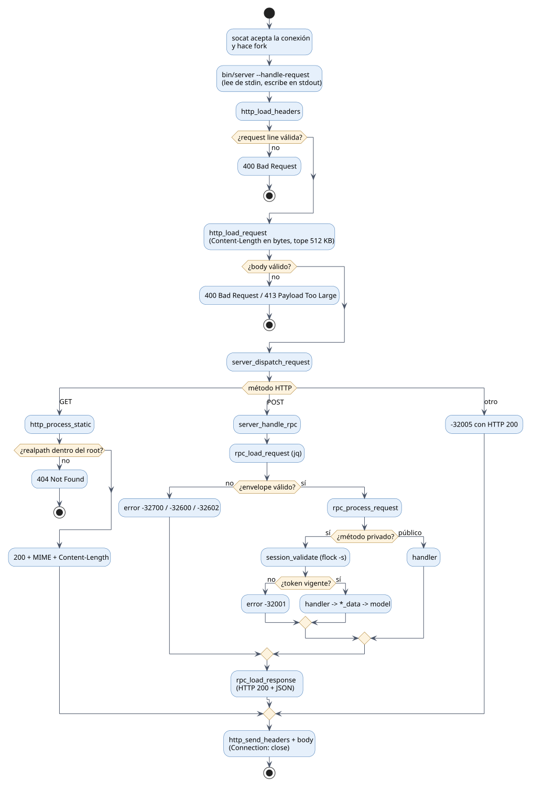
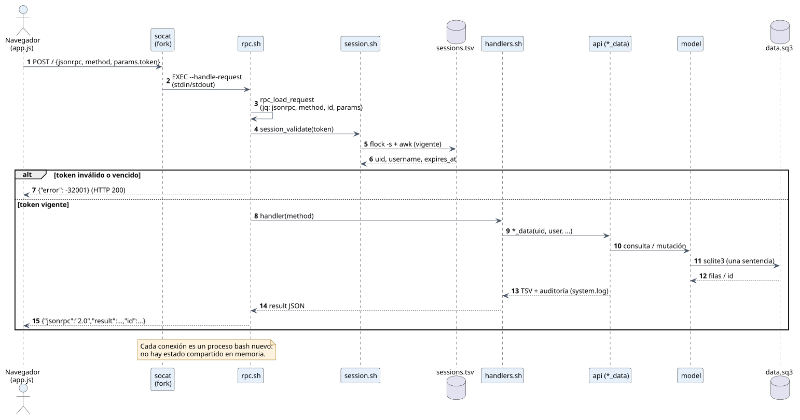
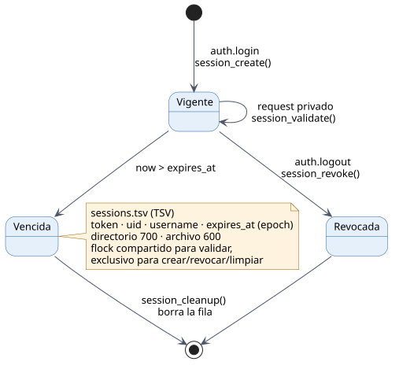

# 02 — Flujos

## Ciclo de un request HTTP



Puntos clave:

- `stdout` de `bin/server --handle-request` es **solo** la respuesta HTTP; los
  diagnósticos van a `stderr` o `error.log`.
- `Content-Length` se mide en **bytes** (`wc -c`), no en caracteres; el tope es
  512 KB (`HTTP_MAX_REQUEST_BODY_SIZE = 524288`).
- Los errores de **aplicación** viajan con HTTP 200 y envelope `error`; solo
  los fallos de transporte/estáticos usan 4xx.
- La conexión se cierra siempre (`Connection: close`); no hay keep-alive.

## GET: estáticos y reporte

`http_process_static` resuelve el path sin query string:

| Ruta | Se resuelve contra | Ejemplo |
|---|---|---|
| `/` | `static/index.html` | UI end-user |
| `/<archivo>` | `static/<archivo>` | `/app.js`, `/styles.css`, `/favicon.ico` |
| `/report/<archivo>` | `dirname(PRODUCTS_HTML)/<archivo>` | `/report/productos.html` |

Protección de path traversal:

1. `realpath -m` normaliza root y archivo.
2. El archivo debe empezar con el root **con `/` final**.
3. Debe existir y ser un archivo regular; si no, `404`.

El prefijo con `/` final evita que `/var/report-otro` pase como `/var/report`.
La misma protección aplica a `static/` y a `var/report/`.

MIME explícito (sin `xdg-mime`): `html`, `css`, `js`, `json`, `svg`, `ico`,
`png`, `jpg/jpeg`, `gif`, `webp`, `woff`, `woff2`, `txt` y fallback
`application/octet-stream`. El detalle está en
[03 — Referencia](03-referencia.md#mime-de-estáticos).

## POST público

Métodos: `saludar`, `auth.register`, `auth.login`.

```text
POST /  →  rpc_load_request (jq)
        →  rpc_process_request
        →  handler público
        →  rpc_load_response (HTTP 200)
```

- `auth.register` valida username/password, hashea y persiste; devuelve
  `{uid, username}`.
- `auth.login` verifica el hash, audita `login username="..."` y crea una
  sesión; devuelve `{token, uid, username, expires_at}`.
- Un fallo de credenciales es silencioso (sin log), igual que en CLI/TUI.

## POST privado

Métodos: `auth.logout`, `products.*`, `report.generate`.



La validación de sesión ocurre **antes** de invocar el handler:

1. `rpc_process_request` busca el método en `RPC_PRIVATE_HANDLER`.
2. Extrae `params.token` y llama a `session_validate`.
3. Si falta, es inválido o está vencido → `-32001` (HTTP 200).
4. Si es válido, setea `RPC_SESSION_UID` y `RPC_SESSION_USER` y llama al
   handler.

Los handlers **no** vuelven a chequear el token: reciben la identidad ya
resuelta y la usan para la auditoría (`log_action`).

## Mapeo de errores

Las variantes `*_data` de la API devuelven códigos estables; los handlers los
traducen sin duplicar reglas:

| `*_data` | Situación | RPC | HTTP |
|---|---|---|---|
| `0` | ok | `result` | 200 |
| `10` | dato inválido | `-32602` | 200 |
| `11` | usuario duplicado | `-32004` | 200 |
| `11` | producto inexistente | `-32003` | 200 |
| `11` | credenciales inválidas | `-32002` | 200 |
| `12` | error interno | `-32603` | 200 |

Errores de transporte/estáticos:

| Situación | Respuesta |
|---|---|
| request line inválida | `400 Bad Request` |
| `Content-Length` inválido | `400 Bad Request` |
| body > 512 KB | `413 Payload Too Large` |
| estático inexistente o traversal | `404 Not Found` |
| método HTTP distinto de GET/POST | `-32005` con HTTP 200 |

## Ciclo de sesión



- Archivo: `var/session/sessions.tsv` (TSV).
- Formato: `token<TAB>uid<TAB>username<TAB>expires_at` (epoch).
- Token: 32 bytes de `/dev/urandom` hasheados con SHA-256 (64 hex).
- TTL: `SESSION_TTL` (default 3600 s).
- Permisos: directorio `700`, archivo `600`.
- Concurrencia:
  - `flock -s` para validar (varios lectores).
  - `flock -x` para crear, revocar y limpiar.
  - Revocación y limpieza con archivo temporal + `mv` (nunca `sed -i`).
- `session_create` limpia vencidas antes de appendear la nueva.
- `auth.logout` revoca; `session_cleanup` borra vencidas (idempotente).

Nunca se loguean tokens ni contraseñas, ni se devuelven en errores.

## Generación del reporte

1. `report.generate` (privado) valida la sesión.
2. `generate_report_data` lee las filas con `model_product_list`.
3. Escribe `PRODUCTS_HTML` desde cero:
   - `<title>Productos</title>`
   - `<table>` con encabezados `ID`, `Nombre`, `Precio`
   - una fila por producto.
4. Audita `reporte` en `system.log`.
5. Devuelve `{path, url}`; `url` es `/<HTTP_REPORT_PREFIX>/<basename>`.

`GET /report/productos.html` sirve el archivo desde
`dirname(PRODUCTS_HTML)`, con la misma defensa de traversal que `static/`.

## CLI/TUI vs web

Los tres clients comparten la misma API:

```text
CLI  ─┐
TUI  ─┼─> lib/api ─> lib/model ─> SQLite
Web  ─┘
```

- CLI/TUI usan las funciones **formateadoras** (`add_product`,
  `list_products`, etc.), que conservan los mensajes exactos del Lab 06.
- La web usa las variantes `*_data`, que devuelven TSV/valores.
- Ambas variantes comparten validación, hash, auditoría y reporte.
- La regresión de transparencia compara stdout, `system.log`, `error.log` y
  `productos.html` contra `ejercicio-4`; el resultado es idéntico.

## Lectura siguiente

- [03 — Referencia](03-referencia.md): tablas completas y formatos.
- [04 — Operación](04-operacion.md): cómo reproducir y diagnosticar.
