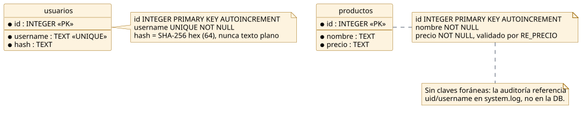

# 03 — Referencia

Contrato observable de la app: HTTP, JSON-RPC, variables de entorno, archivos,
schema y formatos. Si algo cambia acá, cambia el contrato.

## Endpoints HTTP

| Método | Ruta | Resultado |
|---|---|---|
| `GET` | `/` | `static/index.html` (UI) |
| `GET` | `/<archivo>` | archivo de `static/` con MIME explícito |
| `GET` | `/report/<archivo>` | archivo de `dirname(PRODUCTS_HTML)` |
| `POST` | `/` | request JSON-RPC 2.0 |
| otro | cualquiera | `-32005` con HTTP 200 |

Headers de respuesta: `Content-Type`, `Content-Length` (bytes),
`Connection: close`, `X-Content-Type-Options: nosniff`. Las respuestas RPC
agregan `Cache-Control: no-store`.

## Superficie RPC

`POST /` con `Content-Type: application/json`.

| Método | Tipo | params | result |
|---|---|---|---|
| `saludar` | público | — | `"Saludos desde el servidor en bash!"` |
| `auth.register` | público | `{username, password}` | `{uid, username}` |
| `auth.login` | público | `{username, password}` | `{token, uid, username, expires_at}` |
| `auth.logout` | privado | `{token}` | `{ok: true}` |
| `products.list` | privado | `{token}` | `{products: [{id, nombre, precio}]}` |
| `products.add` | privado | `{token, nombre, precio}` | `{id, nombre, precio}` |
| `products.update` | privado | `{token, id, nombre, precio}` | `{id, nombre, precio}` |
| `products.remove` | privado | `{token, id}` | `{id}` |
| `report.generate` | privado | `{token}` | `{path, url}` |

Los métodos privados validan `params.token` **antes** de ejecutar el handler.
El token viaja en el body (no hay cookies, CORS ni headers de autorización).

### Envelope

Éxito:

```json
{"jsonrpc":"2.0","result":{"ok":true},"id":1}
```

Error:

```json
{"jsonrpc":"2.0","error":{"code":-32003,"message":"Not found","data":"El producto no existe."},"id":2}
```

### Reglas del request

- `jsonrpc` debe ser exactamente `"2.0"`.
- `method` debe ser string no vacío.
- `id` puede ser string, number o `null`.
- `params` puede ser objeto o `null`; un array se rechaza con `-32602`.
- Batch (array en la raíz) se rechaza con `-32600`.
- Las notificaciones (sin `id`) se responden con `id: null`; no hay
  procesamiento especial.
- Un body vacío o JSON inválido devuelve `-32700`.

## Códigos de error

| Código | Significado | HTTP |
|---|---|---|
| `-32700` | JSON inválido | 200 |
| `-32600` | request inválido (`jsonrpc` ≠ 2.0, sin `method`, batch) | 200 |
| `-32601` | método inexistente | 200 |
| `-32602` | params inválidos | 200 |
| `-32603` | error interno | 200 |
| `-32001` | no autorizado: token ausente, inválido o vencido | 200 |
| `-32002` | credenciales inválidas | 200 |
| `-32003` | producto inexistente | 200 |
| `-32004` | usuario duplicado | 200 |
| `-32005` | método HTTP no permitido | 200 |

Los errores de aplicación siempre usan HTTP 200 con envelope `error`. Los 4xx
se reservan para transporte/estáticos: `400` request inválido, `404` archivo
inexistente o traversal, `413` body > 512 KB.

## Códigos de las variantes `*_data`

| Código | Significado | Uso web |
|---|---|---|
| `0` | ok | `result` |
| `10` | dato inválido | `-32602` |
| `11` | conflicto / inexistente / credenciales | `-32004` / `-32003` / `-32002` |
| `12` | error interno | `-32603` |

Las funciones históricas (`add_product`, etc.) traducen cualquier fallo a
`return 1` y conservan los mensajes de CLI/TUI.

## Variables de entorno

| Variable | Default | Uso |
|---|---|---|
| `APP_ROOT` | `.` | raíz de trabajo de la app |
| `DB` | `var/db/data.sq3` | base SQLite (fuente de verdad) |
| `LOG` | `var/log/system.log` | auditoría de éxitos |
| `ERRLOG` | `var/log/error.log` | errores de ejecución |
| `PRODUCTS_HTML` | `var/report/productos.html` | reporte derivado |
| `HTTP_SERVER_HOST` | `0.0.0.0` | interfaz de escucha |
| `HTTP_SERVER_PORT` | `8080` | puerto |
| `HTTP_STATIC_PATH` | `static` | root de estáticos |
| `SESSION_DIR` | `var/session` | directorio de sesiones |
| `SESSIONS_FILE` | `$SESSION_DIR/sessions.tsv` | archivo de sesiones |
| `SESSION_TTL` | `3600` | TTL en segundos |

Constantes inmutables relevantes: `HTTP_DEFAULT_PATH=index.html`,
`HTTP_REPORT_PREFIX=report`, `HTTP_MAX_REQUEST_BODY_SIZE=524288`,
`HTTP_SERVER_VERSION=v1.0.0`.

## Archivos y formatos

| Path | Formato | Notas |
|---|---|---|
| `var/db/data.sq3` | SQLite | creada solo por `scripts/deploy.sh` (`make init`) |
| `var/log/system.log` | TSV | `fecha/hora<TAB>id<TAB>usuario<TAB>acción` |
| `var/log/error.log` | texto | `fecha/hora<TAB>mensaje` |
| `var/report/productos.html` | HTML | derivado, regenerable |
| `var/session/sessions.tsv` | TSV | `token<TAB>uid<TAB>username<TAB>expires_at` |
| `var/session/sessions.tsv.lock` | lock | `flock` sobre este archivo |

Acciones auditadas en `system.log`:

```text
registro username="..."     login username="..."     listado
alta id="N"                 edición id="N"           baja id="N"       reporte
```

Permisos de sesión: `SESSION_DIR` `700`, `sessions.tsv` `600`. `var/session/`
está en `.gitignore`; nunca se versionan tokens.

## Schema

```sql
CREATE TABLE IF NOT EXISTS usuarios(
  id INTEGER PRIMARY KEY AUTOINCREMENT,
  username TEXT UNIQUE NOT NULL,
  hash TEXT NOT NULL
);

CREATE TABLE IF NOT EXISTS productos(
  id INTEGER PRIMARY KEY AUTOINCREMENT,
  nombre TEXT NOT NULL,
  precio TEXT NOT NULL
);
```



Sin claves foráneas: la auditoría referencia `uid`/`username` en el log, no en
la base.

## Contratos e invariantes

- Los IDs son autogenerados por SQLite (`AUTOINCREMENT`); el alta nunca pide id.
- `username` cumple `RE_USER = ^[A-Za-z0-9_.-]+$`.
- `password` no puede estar vacía; se persiste solo el hash SHA-256 hex de 64
  caracteres. Nunca texto plano.
- `precio` cumple `RE_PRECIO = ^[0-9]+(\.[0-9]{1,2})?$`.
- `id` de producto cumple `RE_REF_ID = ^[0-9]+$`.
- SQL: keywords en MAYÚSCULAS, identificadores en minúsculas, una sentencia por
  invocación, valores siempre por `sql_escape`, sin `SELECT *`.
- `data.sq3` la crea `scripts/deploy.sh` (`make init`); el runtime solo hace
  `require_db` y nunca crea schema.
- El reporte tiene `<title>Productos</title>` y una `<table>` con `ID`,
  `Nombre`, `Precio`.
- Los logs son TSV de 4 columnas; los errores van a `error.log` y los éxitos a
  `system.log`.
- Tokens y contraseñas no aparecen en logs ni en respuestas de error.

## MIME de estáticos

| Extensión | `Content-Type` |
|---|---|
| `.html`, `.htm` | `text/html; charset=utf-8` |
| `.css` | `text/css; charset=utf-8` |
| `.js`, `.mjs` | `application/javascript; charset=utf-8` |
| `.json` | `application/json; charset=utf-8` |
| `.svg` | `image/svg+xml` |
| `.ico` | `image/x-icon` |
| `.png` | `image/png` |
| `.jpg`, `.jpeg` | `image/jpeg` |
| `.gif` | `image/gif` |
| `.webp` | `image/webp` |
| `.woff` | `font/woff` |
| `.woff2` | `font/woff2` |
| `.txt` | `text/plain; charset=utf-8` |
| otro | `application/octet-stream` |

## Límites conocidos

- HTTP/1.1, una conexión por request, sin keep-alive.
- Body máximo: 512 KB (`413` si se supera).
- Sin TLS, sin CORS, sin cookies, sin CSRF tokens: pensado para mismo origen.
- Notificaciones JSON-RPC sin `id` se responden con `id: null`; batch fuera de
  alcance.
- `make dist` bundlea solo CLI/TUI; la web necesita `static/`, `jq`, `socat` y
  la DB.
