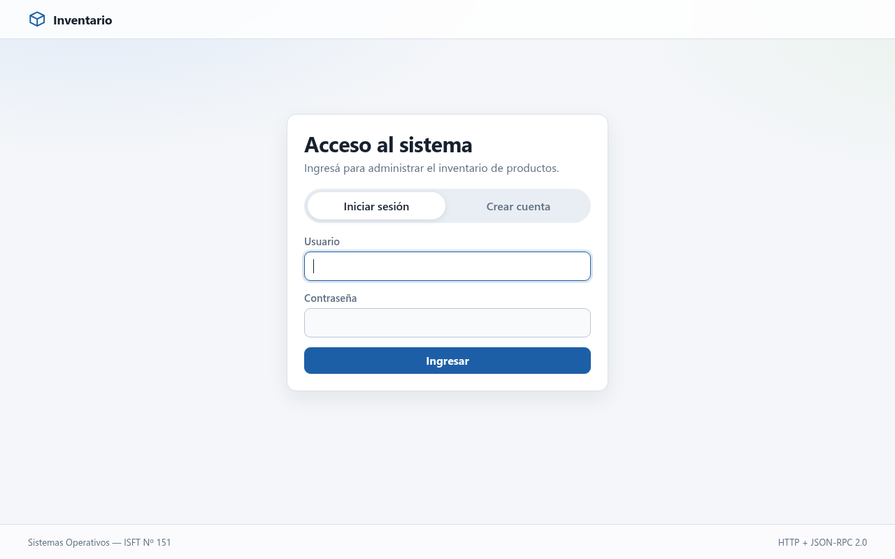
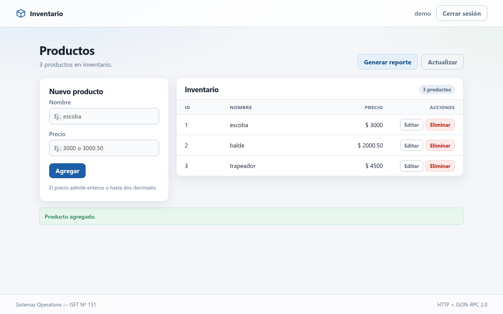

# Documentación — Lab 07 (ejercicio-5)

Documentación de arquitectura, flujos, contrato y operación de la app de
inventario con clients CLI, TUI y web (HTTP + JSON-RPC 2.0).

Este directorio es un **deep-dive**. Las fuentes de verdad del repo son:

| Tema | Fuente canónica |
|---|---|
| Uso diario y quickstart | [`../README.md`](../README.md) |
| Reglas durables de desarrollo | [`../AGENTS.md`](../AGENTS.md) |
| Estado y checkpoints del lab | [`../HANDOFF.md`](../HANDOFF.md) |
| Contrato HTTP/RPC y formatos | [`03-referencia.md`](03-referencia.md) |

## Mapa de lectura

| Si querés… | Leé |
|---|---|
| Entender cómo se arma el sistema y por qué | [01 — Arquitectura](01-arquitectura.md) |
| Seguir un request de punta a punta | [02 — Flujos](02-flujos.md) |
| Consultar métodos, códigos, env vars o formatos | [03 — Referencia](03-referencia.md) |
| Levantarlo, diagnosticar o hacer backup | [04 — Operación](04-operacion.md) |
| Ver qué se decidió y qué alternativas se descartaron | [05 — Decisiones](05-decisiones.md) |

## Índice

1. [Arquitectura](01-arquitectura.md)
   - topología de ejecución, capas, módulos, entrypoints y archivos.
2. [Flujos](02-flujos.md)
   - ciclo HTTP, estáticos, RPC público/privado, sesión, reporte y CLI/TUI.
3. [Referencia](03-referencia.md)
   - endpoints, métodos RPC, errores, variables, schema, MIME y contratos.
4. [Operación](04-operacion.md)
   - instalación, arranque, runbook, backup, seguridad y verificación.
5. [Decisiones](05-decisiones.md)
   - ADRs cortos con contexto, decisión y consecuencias.

## Diagramas

Los diagramas son **docs-as-code**: la fuente es PlantUML (`.puml`) y el SVG se
compila y se versiona. No se edita el SVG a mano.

| Diagrama | Tipo | Uso |
|---|---|---|
| [`runtime.svg`](diagrams/runtime.svg) | deployment | topología host, `socat`, procesos y archivos |
| [`layers.svg`](diagrams/layers.svg) | component | dependencias permitidas entre capas |
| [`request-lifecycle.svg`](diagrams/request-lifecycle.svg) | activity | ciclo de un request HTTP |
| [`rpc-private.svg`](diagrams/rpc-private.svg) | sequence | método privado con validación de sesión |
| [`session-states.svg`](diagrams/session-states.svg) | state | ciclo de vida de una sesión |
| [`data-model.svg`](diagrams/data-model.svg) | ER | tablas `usuarios` y `productos` |

Regeneración:

```bash
make docs        # requiere plantuml + java (+ graphviz)
make docs-check  # valida sintaxis; aviso si plantuml no está
```

El detalle de cada fuente y las convenciones de edición están en
[`diagrams/README.md`](diagrams/README.md).

## Capturas

Las capturas se toman de la UI real a 1280×800 y se versionan en
[`assets/`](assets/); son ilustrativas, no parte del contrato.





## Convenciones

- Los paths de esta documentación son relativos a `ejercicio-5/`.
- La prosa va en español; los identificadores y nombres de archivo, como en el
  código (inglés).
- Los bloques de shell son reproducibles en Linux con las dependencias del
  [README principal](../README.md).
- Las capturas de [`assets/`](assets/) son ilustrativas y se regeneran desde la
  UI real; no son parte del contrato.
